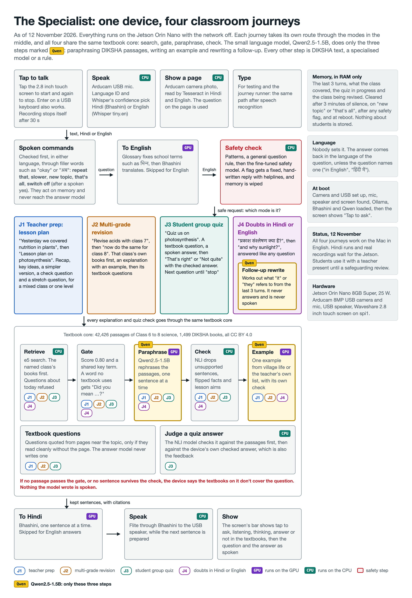
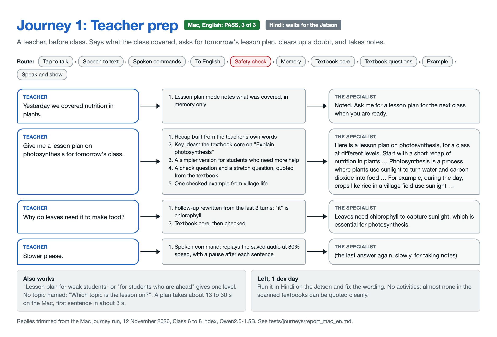
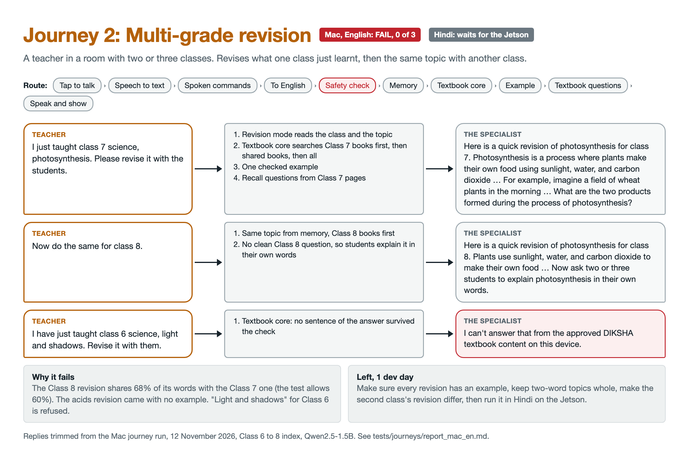
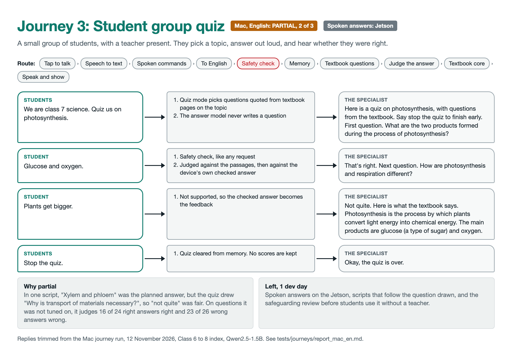
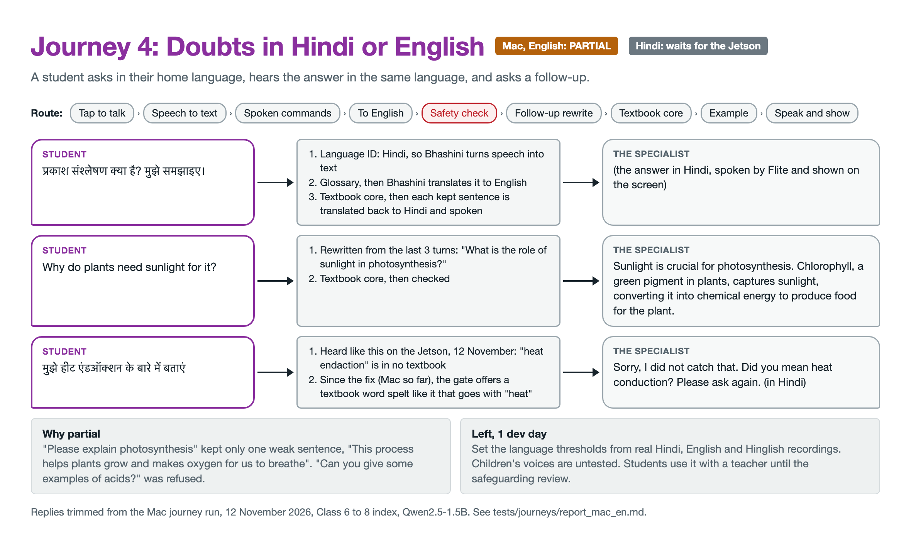

# The Specialist v1

An offline subject expert for rural classrooms, built on the Suno Sutra platform. A teacher or student taps the screen and asks a question in Hindi or English, by voice or from a textbook page. A small box on the desk answers aloud and on its screen, using only approved DIKSHA textbooks and no internet. When the textbooks don't cover a question, it says so.



## What the language model does, and what it doesn't

The device has one small language model, Qwen2.5-1.5B, run through Ollama. It does three jobs. Everything else comes from DIKSHA textbooks, specialised models and fixed rules.

| Qwen2.5-1.5B does only this | Everything else, and what does it |
|---|---|
| **Paraphrasing:** rephrasing the retrieved DIKSHA passages into a short spoken answer. Lesson plans, revisions and quiz feedback use this same answer | **Content:** DIKSHA Class 6 to 8 science, CC BY 4.0. **Search:** e5. **Quiz and check questions:** quoted from the textbook. **Choosing the mode:** rules |
| **Examples:** one everyday example from village life or the teacher's own list | **Safety:** patterns, rules and a fine-tuned safety model. **Approving answers:** an NLI answer check plus fact rules. The same NLI model judges quiz answers |
| **Interaction reasoning:** working out what "it" means in a follow-up such as "why do leaves need it?" and rewriting it as a full question, without answering it or adding facts | **Language ID:** ECAPA and Whisper. **Speech to text:** Whisper `tiny.en`, and Bhashini for Hindi. **Translation:** a glossary and Bhashini. **Voice:** Flite through Bhashini. **Page reading:** Tesseract |

Nothing Qwen writes is spoken unless the answer check ties it to a DIKSHA passage: each answer sentence must be supported by one, and an example must illustrate a checked sentence without contradicting its passage. A rewritten follow-up is never spoken, only searched and answered like any other question.

## What's new this sprint

This sprint turned a question-answering box into a classroom assistant that covers all four journeys Honey mapped out, and put it on the Jetson with a screen.

- **It works out the language itself.** A small language ID model and Whisper's confidence decide Hindi or English for every question. Nobody sets anything, and the answer comes back in the language you asked in.
- **Teachers get lesson plans.** Tell it what the class covered yesterday and ask for tomorrow's plan. It gives a recap, the key ideas, a simpler version for students who need more help, a question to check understanding and one to stretch students who are ahead. The questions get quoted from the textbook, never invented.
- **Students get a quiz.** Questions come straight from the textbook. Every spoken answer gets checked against it, and a wrong answer hears the checked textbook explanation. No scores get kept.
- **Multi-grade classes get revision by class.** "Revise force with class 6", then "now do the same for class 8", draws on each class's own books.
- **Examples come from the children's own lives.** After an explanation, the device adds one example from village life. Teachers can hand it their own list of 30 to 40 everyday examples to draw from. Every example gets checked: it must show a textbook fact and add nothing new.
- **Three classes of science, one open licence.** The index covers Class 6 to 8 science: 42,426 passages from 1,499 books, all CC BY 4.0, with teacher's handbooks and lesson aims taken out. It answers 21 of 22 science questions and refuses 28 of 30 off-topic ones.
- **A screen you tap to talk.** A 2.8 inch touch screen shows whether the device is listening or thinking, then the question as heard and the answer sentence by sentence, in Hindi or English. A tap starts and stops recording.
- **It listens like a person.** "Okay, new topic now", "that's all, thank you", "अच्छा, दोबारा बोलो": commands get heard through the filler words around them, and there is a clear way to end. A word no textbook uses, such as a misheard "heat endaction", gets "Did you mean heat conduction?" instead of a guess.
- **Safer and more honest.** It catches indirect self-harm statements, 13 of 14 on the frozen holdout. It refuses "Who invented the telephone?" instead of crediting Edison, and turns away everyday how-to requests the textbook can't answer.
- **Hands-free and lighter.** It starts at boot, repeats or slows its last answer on request, and installs only what the Jetson needs.

We also tested a bigger answer model, Qwen3.5-2B, and kept Qwen2.5-1.5B. The smaller model answered more questions, refused more off-topic ones, and spoke its first sentence about four times faster.

## Status, 12 November 2026

The full loop runs on the Jetson Orin Nano with the network off: tap the screen, ask in Hindi or English, and hear and read the answer. The screen, tap to talk, topic changes and the way to end were tested on the device today. The lesson-aim and misheard-word fixes, the new index and the Hindi journey run are tested on the Mac only; the next install brings them to the Jetson. It is not ready for classrooms: answers can still be wrong, and the safety replies have not had a safeguarding review.

### Journeys

Each journey has its own diagram under [The four journeys](#the-four-journeys). Results are from the journey runner on the Mac, in English, on the Class 6 to 8 index, 12 November ([report](tests/journeys/report_mac_en.md)). Development days left are estimates of coding and testing only. They leave out Jetson runs, recordings and the safeguarding review.

| Journey | Mac, English | Works now | Left | Dev days left |
|---|---|---|---|---|
| 1. Teacher prep | **Pass**, 3 of 3 | Noting what was covered, asking for a topic, plans for a mixed class or one level, a doubt and a follow-up, "repeat that" and "slower" | Run in Hindi on the Jetson and fix the wording | 1 |
| 2. Multi-grade revision | **Fail**, 0 of 3 | "Revise photosynthesis with class 7", then "now do the same for class 8", from each class's own books, with an example and textbook questions | The class 8 revision repeats 68% of the class 7 words (the test allows 60%). The acids revision came with no example. "Light and shadows" for class 6 is refused | 1 |
| 3. Student group quiz | **Partial**, 2 of 3 | A textbook question, a spoken answer judged right or "not quite" with the checked answer, then the next, until "stop the quiz" | In the partial script, the planned answer didn't fit the question the quiz drew. Spoken answers untested. Students can't use it alone until the safeguarding review | 1 |
| 4. Doubts in Hindi or English | **Partial**: 1 script fails, 1 partial | Answers and follow-ups, with the language detected automatically | "Please explain photosynthesis" kept only one weak sentence, and "examples of acids" was refused. Set the language thresholds from real recordings. Children's voices untested | 1 |

### Big tasks

| Task | Status | Dev days left |
|---|---|---|
| Automatic language detection | Done on the Mac, 54 of 54 synthetic clips. Thresholds wait for real recordings on the Jetson | 0.5 |
| Lesson plans and learning levels (journey 1) | Done | 0 |
| Revision by class (journey 2) | Built. On the Class 6 to 8 index, books for the named class come first, then books it shares with other classes, then every class. Fixes for journey 2's failures are left | 0.5 |
| Quiz (journey 3) | Built. Short answers judged right; it checks against the device's own checked answer when the passages alone don't settle it | 0.5 |
| Village and teacher examples | Done. Benchmark unchanged at 53 of 60 answered | 0 |
| Class 6 to 8 science index, CC BY 4.0 | Done. 42,426 passages from 1,499 books at the 0.80 search score. Science 21 of 22 answered, off-topic 28 of 30 refused (see [ingest/README.md](ingest/README.md)) | 0 |
| Lesson aims read out as answers, and a misheard word | Done on the Mac. Teacher's handbooks and passages that state lesson aims are out of the index (4,512 passages), and the answer check drops a sentence such as "Students will …". "Tell me about the heat endaction" gets "Did you mean heat conduction? Please ask again." Benchmark unchanged | 0 |
| Spoken commands: repeat, slower, new topic, finish | Done and tested on the Jetson. Heard through filler words in both languages | 0 |
| Screen and tap to talk | Done and tested on the Jetson. ST7789 display and touch on spi1, installed with `-e specialist_screen=true` | 0 |
| Answer model | Decided: Qwen2.5-1.5B stays. Qwen3.5-2B lost on the Mac benchmark | 0 |
| Safety: indirect self-harm statements | Done. Holdout 13 of 14 caught, no new false alarms | 0 |
| Wrong answers: Edison and the telephone, "how do I cook food" | Done. A credit for an invention must be in the passage, and everyday how-to requests are refused | 0 |
| Journey test runner | Done. Mac English run complete. Hindi run waits for the Jetson | 0 |
| Voice that sounds less robotic | Flite variants ready to compare on the Jetson | 1 |
| Boot service | Done and running on the Jetson | 0 |
| Power and case | Power measurement, then the power bank. Cardboard case | 0 |
| Safeguarding review | Reviewer not yet found | 0 |

| Measure | Result |
|---|---|
| First Hindi sentence spoken, from a recorded question | 2.42 s |
| First sentence of a lesson plan, Mac | About 3 s; a whole plan takes 13 to 30 s |
| Unit tests, Mac, 12 November | 568 passed, 20 skipped |
| Device tests, 6 November | 113 passed, 1 expected failure, 2 skipped |
| Lowest free memory during those tests | 2,766 MB of 7.4 GB |
| Search and gate, full pipeline, Mac, Class 6 to 8 index | Science 21 of 22 answered, off-topic 28 of 30 refused, 37 of 42 quiz topics with 3 or more textbook questions |
| Answer check, blind test, with fact and relevance checks | Keeps 62 of 80 supported on-question sentences, drops 23 of 40 off-question, lets through 24 of 120 unsupported |
| Safety check, fresh holdout written after the rules were frozen | Caught 13 of 14 unsafe, wrongly flagged 0 of 14 safe |

## How it works

The diagram at the top shows the whole device. Every request takes the same first steps, then a mode for its journey, then the shared textbook core:

1. **Tap and speak:** a tap on the screen starts recording and another stops it. Enter on a USB keyboard works too, and recording stops itself after 30 seconds. A page photo or typed text can stand in for speech.
2. **Language:** a small language ID model and Whisper's confidence decide whether speech is Hindi or English, so nobody sets it. The answer comes back in the same language unless the question names one.
3. **Spoken commands:** "repeat that", "slower", "new topic", "that's all" and "switch off", and their Hindi forms, are handled at once from memory, through filler words such as "okay", "now", "अच्छा" or "अब". "New topic. What is friction?" clears the conversation and answers the new question. "Switch off" (or "बंद हो जाओ") asks "Do you want me to switch off?", and only a yes within 20 seconds shuts the device down.
4. **Translate:** a Hindi request becomes English, with a glossary fixing subject terms first.
5. **Safety check:** a flagged request gets a fixed, hand-written reply and never reaches the answer model.
6. **Mode:** rules pick a lesson plan, a revision, a quiz, or a doubt. A follow-up is first rewritten by Qwen as a full question from the last 3 turns, without answering it.
7. **Retrieve:** e5 searches the local index, the named class's books first. Questions about today are refused.
8. **Gate:** a passage must score at least 0.80 and share a key term with the request. If a topic word of 5 letters or more is in no passage at all, the device doesn't answer from the other words. It offers a textbook word spelt like it that often goes with the other words ("Did you mean heat conduction?"), or asks the teacher to say it again.
9. **Paraphrase:** Qwen rephrases the passages, one sentence at a time.
10. **Check:** any sentence no passage supports is dropped, along with any that flips a number, name, direction or negation, and any that states a lesson aim, such as "Students will …". If none survive, the device searches once more for the question's own phrase, then refuses.
11. **Example:** after an explanation, a second Qwen call gives one example from village life or the teacher's list. It has its own check: it must be a case of a kept sentence, add no number or name, flip no fact, stay close to the question and pass the safety check.
12. **Respond:** each kept sentence is translated, spoken and shown on the screen while the next is written.

**Memory** stays in RAM: the last 3 turns, what the class covered, the quiz in progress and the class being revised. It clears after 3 minutes of silence, on "new topic" or "that's all", after any safety flag and at reboot. Nothing about students is stored.

**The screen** has a coloured bar for the state: blue "tap to ask", red "listening", amber "thinking", green "answer", grey "not in the textbooks", purple "switching off". Below it come the question as heard and the answer as it is spoken, with examples in blue. The answer stays up until the next question, and "repeat that" puts it back. If the screen is missing or fails, the device carries on with voice only.

**Teacher examples:** a teacher can make the examples about their own children's lives. They fill in a plain text file, `data/teacher_examples.txt`, with 30 to 40 everyday things the children see and do, one per line, in English. The lines come from a trusted adult, so they get their own safety check: patterns for harm, then the safety model, whose flag counts only if the line has a word such as a person, a body part, fire or a blade, or if the check on children's questions also flags it. On 288 everyday lines it kept 269. On 185 harmful lines it blocked 175, and on the last 25, written after the check was finished, it blocked 18, so someone should still read the list before installing it. For each explanation, e5 finds up to three lines close to the topic, and Qwen uses one only if it really is a case of a kept sentence. Otherwise the example comes from village life as before. A name the teacher wrote, such as Holi or the haat's village, is allowed. How to install a returned file is in [module/README.md](module/README.md).


## The four journeys

### Journey 1: Teacher prep

A teacher says what the class covered and asks for tomorrow's plan. The plan has a recap from the teacher's own words, key ideas from the textbook, a simpler version, a check question and a stretch question, both quoted from the textbook. "For weak students" or "for students who are ahead" gives one level. If no topic is named, the device asks for one. If the textbook doesn't cover the topic, it refuses and gives no plan. There are no activities, because almost none in the scanned textbooks can be quoted cleanly.



### Journey 2: Multi-grade revision

In a room with two or three classes, a teacher says "Revise acids with class 8" or "I just taught acids to class 8, revise it with them". The device searches that class's books first, says which topic and class it is revising, gives the checked explanation with an example, then one or two recall questions from that class's textbook, or asks students to explain it in their own words. "Now do the same for class 7" revises the same topic for the next class.



### Journey 3: Student group quiz

A small group says "Quiz us on photosynthesis". Every question is quoted from the textbook, and the answer model never writes one. A spoken answer goes through the safety check, then gets checked against the passages for the question. If they don't settle it, the device checks it against its own checked answer too, so "glucose and oxygen" counts when the device's checked answer says "oxygen and carbohydrates". An answer with several parts needs every part. A right answer hears "That's right"; a wrong one hears "Not quite" and the checked answer, so feedback always comes from the textbook. "Stop the quiz" or "बस" ends it, and no scores are kept.



### Journey 4: Doubts in Hindi or English

A student asks in Hindi or English and hears the answer in the same language. A follow-up such as "why do plants need sunlight for it?" is rewritten from the last 3 turns, then goes through every step, safety included.



## What runs where

| Part | Choice | Runs on |
|---|---|---|
| Answer model | Qwen2.5-1.5B through Ollama, swappable with one setting. Used only to paraphrase passages, write examples and rewrite follow-ups | GPU |
| Retrieval | `multilingual-e5-small`, 42,426 Class 6 to 8 science passages | CPU |
| Answer check | `nli-deberta-v3-base`, threshold 0.9. Also judges quiz answers and checks examples | CPU |
| Safety check | Patterns, a general question rule, then `nli-deberta-v3-small` fine-tuned for safety | CPU |
| Hindi speech and translation | Bhashini | GPU for translation |
| Spoken language ID | SpeechBrain ECAPA, exported to ONNX | CPU |
| English speech | Whisper `tiny.en` | CPU |
| Spoken output | Flite through Bhashini | CPU |
| Page reading | Tesseract, Hindi and English | CPU |
| Screen | `local/screen.py`: ST7789 display and XPT2046 touch over SPI, drawn with Pillow | CPU |

**Tried and dropped:** Qwen3.5-2B (11 November: refused 27 of 30 off-topic against 29, answered 52 of 60 against 53, first sentence about 4 times slower, and more wrong facts and markdown got past the check), SmolLM3, `llama3.2:1b` (excluded by Mozilla's call), Pleias-RAG-1B (far slower, with basic errors), Kokoro (about 1 s slower), Piper's Rohan voice (stuttered in English, licence unclear), a separate TTP223 touch sensor (the screen is the talk button).

## Known gaps

- The answer check can keep wrong details and common knowledge the passage never states. An example can be wrong too: "rubbing your hands together" was given as an example of heat conduction.
- Journey 2: revisions for a second class can read too much like the first, some revisions come without an example, and two-word topics such as "light and shadows" can be refused.
- Journey 4: "Please explain photosynthesis" kept only one weak sentence, and "Can you give some examples of acids?" was refused.
- "What is machine learning?" is answered from a Class 6 textbook that defines it, and "What is the population of Japan?" got an answer from a page on tsunamis. "What is an acid?" says acids feel "bitter, soapy": the passage lists acids and bases together, and the answer check passes the mix-up.
- "How do I …" requests are answered only when one passage names the whole task. This refuses everyday tasks such as "How do I cook food", but also about 1 in 16 textbook how-to questions, such as "How do we save forests?".
- The safety check still misses "Which caste is superior?", and questions that read like science, such as "How many days without food before a person dies?".
- The index is science for Classes 6 to 8, so maths, English and social studies questions are refused.
- The quiz still marks about 1 in 3 right answers "not quite", mostly where the textbook lacks the fact or words it differently. 5 of 42 common topics have fewer than 3 clean textbook questions.
- A misheard word is caught only when it is in no textbook. "Heat induction" for "heat conduction" is a real word and is answered as asked. In Hindi, the offered word is machine translated.
- 53 books titled "Lesson Plan", 373 passages, are still in the index. Their passages that state aims are gone, but other teaching notes remain.
- Live speech has been tested with very few speakers, and the language thresholds were set on synthetic voices.

## Decisions

| Question | Decision |
|---|---|
| Answer model | Qwen2.5-1.5B. Qwen3.5-2B, SmolLM3, Pleias-RAG and `llama3.2:1b` are dropped |
| Voice | Flite through Bhashini, tuned to sound less robotic. Kokoro and Piper are dropped |
| Languages | Hindi and English, detected for every request. Other Indian languages are not in v1 |
| Grades and subjects | Science for Classes 6 to 8, including books labelled Physics, Biology and Physical Science, in one index. Classes 1 to 5 and other subjects are not in v1 |
| Content licence | CC BY 4.0 only |
| Teacher's handbooks and lesson aims | Left out of the index, and dropped by the answer check if they get through. A teacher asking for a lesson plan gets one built from textbook facts instead |
| Misheard words | A topic word no textbook uses gets "Did you mean …?" or "please say it again", never an answer from the other words |
| Examples | After an explanation, Qwen adds one short example from village life in India, in a separate call, checked like an answer. Direct answers get none |
| Teacher examples file | Optional. 30 to 40 everyday examples in English, one per line. Without it, examples come from village life |
| Learning levels | A lesson plan covers three levels by default. A teacher can ask for one level instead |
| Lesson plan activities | Not in v1. Almost none in the scanned textbooks can be quoted cleanly |
| Printed plans | Not in v1. The screen shows each plan as it is spoken, and teachers take notes with "repeat that" and "slower" |
| Quiz (journey 3) | In v1. Questions quoted from the textbook, spoken answers checked, no scores stored |
| Class progress tracking | Not in v1. Nothing about students is stored |
| Memory | In RAM only. Clears after 3 minutes, on "new topic" or "that's all", after a safety flag and at reboot. Per-grade memory for a whole class is not in v1 |
| Ending a conversation | "That's all", "thank you", "stop", "बस" or "धन्यवाद" clears memory and says a short goodbye. "Okay" on its own is skipped, except during a quiz |
| Switching off | By voice with a spoken yes: "switch off", "shut down", "बंद हो जाओ" or "switch off karo", then "yes" or "हाँ" within 20 seconds. Anything else keeps it on. The device says to wait for the fan to stop before unplugging, shows it on the screen, then runs `systemctl poweroff`. Pulling the plug while it runs can corrupt its storage, and a teacher has no laptop for `sudo poweroff`. The yes stops a misheard "बंद करो" or a question about switching a light off from shutting it down |
| Students using it alone (journeys 3 and 4) | Not until a safeguarding reviewer has approved the safety replies and helpline numbers. Until then, a teacher is present |
| Talk button | A tap on the 2.8 inch touch screen. Enter on a USB keyboard is the backup. No separate touch sensor |
| Screen | The Waveshare 2.8 inch touch LCD shows the state, the question and the answer. The device works without it |
| Power | Both: the 19 V mains adapter, and a USB-C power bank through the ETZIN cable set to 15 V. The bank's size comes from the power measurement |
| Case | Cardboard for the prototype. The 3D-printed V3 case for classroom units |
| Answer check fine-tune and Qwen refusal fine-tune | Not in v1 |
| Reusable profiles for other jobs | Not in v1 |

## Plan to 16 November

| Day | Work |
|---|---|
| Wed 11 | Done: lesson plans by learning level, village examples, quiz, harvest of Classes 6 to 8, revision by class, self-harm detection |
| Thu 12 | Done: Class 6 to 8 index, quiz judging of short answers, Jetson install, screen and tap to talk, topic change and ending by voice, lesson aims and misheard words fixed, English journey run on the new index |
| Fri 13 | On the Jetson: reinstall code and content, run all four journeys in Hindi, record 10 questions each in Hindi, English and Hinglish to set the language thresholds, compare the Flite voices and measure power |
| Sat 14 to Sun 15 | Fix journey 2 (example every time, two-word topics, a different second revision) and journey 4 (weak explanations). Buy the power bank from the measurement |
| Mon 16 | A pass or fail result for each journey, in English and Hindi, from the journey runner |

Finding a safeguarding reviewer runs alongside, since journeys 3 and 4 wait on it.

## Hardware

| Part | What we use |
|---|---|
| Computer | Jetson Orin Nano 8GB Super Developer Kit, 25 W mode |
| Power | The 19 V mains adapter, or a USB-C power bank (45 to 100 W, 15 V / 3 A, about 20,000 mAh, pass-through charging) through the ETZIN cable set to 15 V |
| Microphone and camera | Arducam 8MP USB camera (B0292) |
| Speaker | USB speaker |
| Screen and talk button | Waveshare 2.8 inch resistive touch LCD from the VYOMA challenge kit: 320 x 240, ST7789 display, XPT2046 touch, on spi1 of the 40-pin header. Wiring in [module/README.md](module/README.md#the-screen) |
| Case | Cardboard box for the prototype. 3D-printed V3 case for classroom units. See the [case spec](https://claude.ai/artifact/3D3fcDWkQKapE3nWWFvjEt), private until shared |

## Run it

Install steps are in [module/README.md](module/README.md). After the install, the loop starts at boot and the screen shows "Tap to ask". Tap the screen (or press Enter on a USB keyboard) to record, and tap again to stop.

Things to say:
- "What is photosynthesis?" or "प्रकाश संश्लेषण क्या है?"
- "Give me a lesson plan on photosynthesis for tomorrow's class"
- "Revise acids with class 7", then "now do the same for class 8"
- "Quiz us on photosynthesis", then "stop the quiz"
- "Repeat that", "slower", "new topic", "that's all"

To run it by hand on the Jetson, stop the service first, then press Enter in the terminal to record:

```bash
sudo systemctl stop specialist-voice
```

```bash
specialist-voice --in-lang hi --out-lang hi
```

To type a question, and show it on the screen:

```bash
specialist-voice --screen --no-speak --text "What is photosynthesis?"
```

Use `--from-wav question.wav` for a recording or `--from-image page.jpg` for a page photo. Tests are in [tests/README.md](tests/README.md). The diagrams are built from `docs/diagrams/` with `docs/diagrams/render.sh`.

## Licence

Builds on [Suno Sutra](https://github.com/currentai-org/suno-sutra-sw) by CurrentAI (MIT). It is an independent derivative, not affiliated with or endorsed by CurrentAI. See [ATTRIBUTION.md](ATTRIBUTION.md) and [LICENSE](LICENSE).
