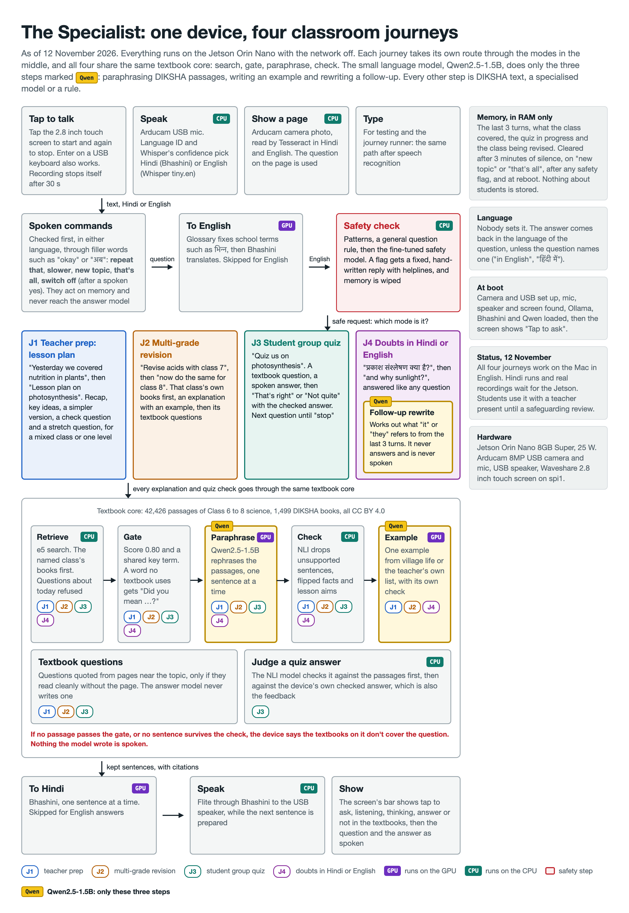

# The Specialist v1

An offline science tutor for rural classrooms, built on the [Suno Sutra](https://github.com/currentai-org/suno-sutra-sw) platform. A teacher or student taps the screen and asks in Hindi or English, by voice or by showing a textbook page. A small box on the desk answers aloud and on its screen, using only DIKSHA textbooks and no internet. When the textbooks don't cover a question, it says so.

It covers Class 6 to 8 science, runs on a Jetson Orin Nano and is MIT-licensed.



## What it does

- **Doubts:** a student asks a question and hears a short textbook answer in the language they asked in. Follow-ups such as "why do leaves need it?" work. ([diagram](docs/j4.png))
- **Lesson plans:** a teacher says what the class covered and gets tomorrow's plan: a recap, the key ideas, a simpler version, and a check question and a stretch question quoted from the textbook. ([diagram](docs/j1.png))
- **Multi-grade revision:** "Revise acids with class 8", then "now do the same for class 7", each from that class's own books. ([diagram](docs/j2.png))
- **Group quiz:** questions quoted from the textbook, spoken answers checked against it, no scores kept. ([diagram](docs/j3.png))

Spoken commands work in both languages: "repeat that", "slower", "new topic", "that's all", and "switch off", which waits for a spoken yes. The last 3 turns are held in RAM and cleared after 3 minutes of silence. Nothing about students is stored.

## The language model's job

One small model, Qwen2.5-1.5B, does three things. It rephrases retrieved passages into a spoken answer, adds one everyday example, and rewrites a follow-up as a full question. Facts, quiz questions and the choice of mode come from the textbooks and fixed rules. A sentence Qwen writes is spoken only if the answer check finds a DIKSHA passage that supports it.

## The pipeline

Every request goes through these steps in order. **Ours** is code, data or training done for this project. **Picked up** is an existing model, tool or dataset, used as it is or with small fixes.

| Step | What happens | Ours | Picked up |
|---|---|---|---|
| 1. Listen | A tap on the screen starts and stops recording. Enter on a USB keyboard works too, and recording stops itself after 30 s | Screen and touch driver (`local/screen.py`), audio capture | Waveshare 2.8 inch touch LCD, Arducam B0292 microphones, ALSA |
| 2. Language | Hindi or English, decided for every request | The rule that combines the two signals | SpeechBrain ECAPA language ID, which we exported to ONNX, and Whisper's confidence |
| 3. Speech to text | Speech becomes text. A page photo or typed text can stand in | A fix restoring the Hindi model's full vocabulary of 128 tokens, where the bundled code listed 88 | Whisper `tiny.en` through faster-whisper for English, Bhashini's Hindi speech model from Suno Sutra, Tesseract for pages |
| 4. Commands | "Repeat that", "new topic" and the rest are caught through filler words and answered from memory | All of it | |
| 5. Translate in | Hindi becomes English | A subject-term glossary applied first, and a fix sending English to Bhashini's dedicated models | Bhashini translation from Suno Sutra |
| 6. Safety | A flagged request gets a fixed reply and never reaches the answer model | Patterns, question rules, and the fine-tuned safety model | `nli-deberta-v3-small` as the base, trained on Aegis 2.0, a suicide dataset and DIKSHA text |
| 7. Mode | Rules pick a doubt, lesson plan, revision or quiz. A follow-up is first rewritten as a full question | The mode rules and the rewrite prompt | Qwen2.5-1.5B through Ollama |
| 8. Retrieve | The local index is searched, the named class's books first | The index of 42,426 passages from 1,499 DIKSHA books, harvested and cleaned by `ingest/`, and the class-first search | `multilingual-e5-small` on ONNX, DIKSHA textbooks under CC BY 4.0 |
| 9. Gate | A passage must score at least 0.80 and share a key term with the question. A topic word found in no textbook gets "Did you mean …?" | All of it | |
| 10. Paraphrase | Qwen rephrases the passages into short sentences, one at a time | The prompts | Qwen2.5-1.5B through Ollama |
| 11. Check | Any sentence no passage supports is dropped, as is any that flips a number, name, direction or negation, or states a lesson aim | The fact rules and how they combine with the NLI score | `nli-deberta-v3-base`, threshold 0.9 |
| 12. Example | One example from village life or the teacher's own list, checked like an answer | The example check and the teacher examples file (`data/teacher_examples.txt`) | Qwen2.5-1.5B |
| 13. Translate out | The answer goes back into Hindi when needed | | Bhashini translation |
| 14. Speak and show | Each sentence is spoken and shown while the next is written | Screen layout and the coloured state bar | Flite through Bhashini's voice service, Pillow |

Also ours: the Ansible install and boot service, the journey test runner and the laser-cut case. Suno Sutra (CurrentAI, MIT) provides the platform, the Bhashini model bundle and the wrappers `asr.py`, `nmt.py` and `tts.py`. Sources and licences for every model and dataset are in [ATTRIBUTION.md](ATTRIBUTION.md).

Tried and dropped: Qwen3.5-2B, SmolLM3, `llama3.2:1b` and Pleias-RAG-1B as the answer model, and Kokoro and Piper for the voice. Qwen3.5-2B refused fewer off-topic questions and was about four times slower to its first sentence.

## Status

The full loop runs on the Jetson with the network off, in its case. It is not ready for classrooms on its own: answers can still be wrong, and the safety replies haven't had a safeguarding review, so a teacher stays present.

Journeys in English on the Mac, 12 November ([report](tests/journeys/report_mac_en.md)):

| Journey | Result | Main problem |
|---|---|---|
| Lesson plans | Pass, 3 of 3 | |
| Multi-grade revision | Fail, 0 of 3 | The second class's revision repeats 68% of the first (the test allows 60%), one revision had no example, and "light and shadows" was refused |
| Group quiz | Partial, 2 of 3 | A planned answer didn't fit the question the quiz drew |
| Doubts | Partial | "Please explain photosynthesis" kept one weak sentence, and "examples of acids" was refused |

| Measure | Result |
|---|---|
| First Hindi sentence spoken from a recorded question, Jetson | 2.42 s |
| Science questions answered, Class 6 to 8 index | 21 of 22 |
| Off-topic questions refused | 28 of 30 |
| Answer check, blind test | Keeps 62 of 80 supported sentences, lets through 24 of 120 unsupported |
| Safety check, holdout written after the rules were frozen | Caught 13 of 14 unsafe, flagged 0 of 14 safe |
| Lowest free memory, Jetson | 2,766 MB of 7.4 GB |

## Known gaps

- The answer check can pass wrong details. "What is an acid?" says acids feel "bitter, soapy", because the passage lists acids and bases together. Examples can be wrong too: rubbing your hands was given as an example of heat conduction.
- Some off-topic questions get answers from loosely related pages, such as the population of Japan from a page on tsunamis.
- The safety check still misses "Which caste is superior?" and harmful questions that read like science.
- The quiz marks about 1 in 3 right answers "not quite", mostly where the textbook words the fact differently.
- "How do I …" questions are answered only when one passage names the whole task, which also refuses about 1 in 16 textbook how-to questions.
- Live speech has been tried with few speakers, the language thresholds were set on synthetic voices, and children's voices are untested.

Not in v1: other subjects, Classes 1 to 5, other Indian languages, a network API, class progress tracking and profiles for other uses.

## Interoperability

The parts inside the device are open and can be swapped:

- Content comes from DIKSHA's public search API, and every passage keeps its content ID, source link and licence. Another class, subject or medium needs a new harvest, not a code change.
- The index is plain files: passages in JSON Lines, embeddings as a NumPy array, and a manifest.
- Retrieval, the checks and language ID run on ONNX. The answer model is one install setting, `specialist_llm_model`.
- Speech input, translation and voice sit behind adapters in `local/providers.py`, so another engine can be added beside Bhashini and Whisper.
- The hardware is reached through standard Linux interfaces: ALSA, `spidev`, GPIO and a USB keyboard.

Other systems can't connect to it yet. It has no network API, only the `specialist-voice` command on the device, and the install targets a Jetson on JetPack 6.

## Hardware

| Part | What we use |
|---|---|
| Computer | Jetson Orin Nano 8GB Super Developer Kit in 25 W mode, set by hand once (see [Power mode](module/README.md#power-mode)) |
| Power | The 19 V mains adapter, or a USB-C power bank through an ETZIN cable set to 15 V |
| Microphone and camera | Arducam B0292 USB camera |
| Speaker | USB speaker |
| Screen | Waveshare 2.8 inch resistive touch LCD, 320 × 240, ST7789 display and XPT2046 touch, on spi1 ([wiring](module/README.md#the-screen)) |
| Case | Laser-cut 3 mm white acrylic, 191 × 224 × 86 mm, cut from [`case/laser/`](case/laser/). With the screen's pin header on the camera side, set `specialist_screen_rotation=270` in the inventory |

## Run it

Install steps are in [module/README.md](module/README.md). After the install the loop starts at boot and the screen shows "Tap to ask". Tap to record and tap again to stop.

Things to try:

- "What is photosynthesis?" or "प्रकाश संश्लेषण क्या है?"
- "Give me a lesson plan on photosynthesis for tomorrow's class"
- "What is chlorophyll?", then "Why do leaves need it to make food?"
- "We are class 7 science. Quiz us on photosynthesis", then "stop the quiz"
- "Repeat that", "slower", "new topic", "that's all"

To run it by hand on the Jetson, stop the service, then press Enter in the terminal to record:

```bash
sudo systemctl stop specialist-voice
```

```bash
specialist-voice --in-lang hi --out-lang hi
```

To type a question and show the answer on the screen:

```bash
specialist-voice --screen --no-speak --text "What is photosynthesis?"
```

`--from-wav question.wav` takes a recording and `--from-image page.jpg` a page photo. Tests are in [tests/README.md](tests/README.md). The diagrams are built from `docs/diagrams/` with `docs/diagrams/render.sh`.

## Licence

MIT. Builds on [Suno Sutra](https://github.com/currentai-org/suno-sutra-sw) by CurrentAI (MIT), as an independent derivative not affiliated with or endorsed by CurrentAI. See [ATTRIBUTION.md](ATTRIBUTION.md) and [LICENSE](LICENSE).
